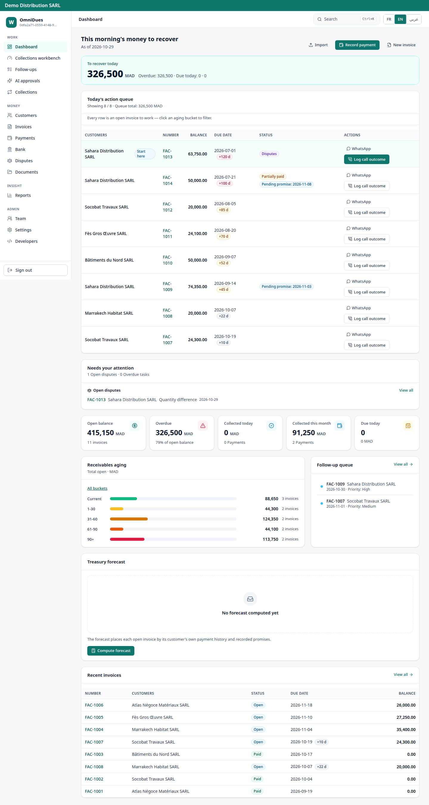
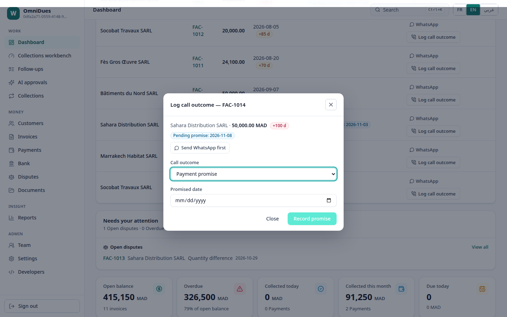
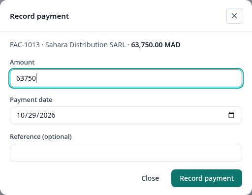
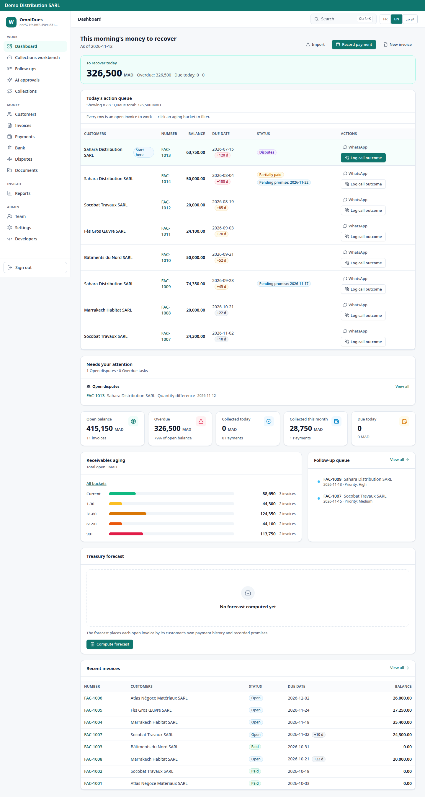
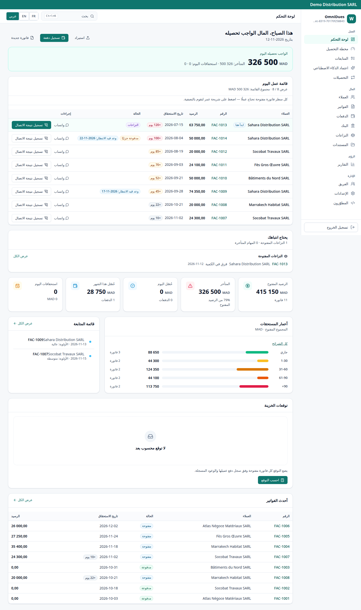

# OmniDues

**A multi-tenant B2B SaaS platform for receivables and collections** — customers, invoices, payments, collections, disputes, and legal escalation, with bank matching and reconciliation, in Arabic, French, and English with strict right-to-left layout.

> **This repository contains documentation only. No source code is published here.**

OmniDues is built for B2B sellers who sell on credit and need their money cycle in one system: what is owed, what was paid, what is overdue, who was contacted, what was promised, what is disputed, and what escalates — with an evidence trail at every step. The first market is distributors and suppliers selling B2B on credit in Morocco, so the product is built on the dirham, local timing, tenant timezones, and quiet hours from the start, not as a later translation.

OmniDues is built under **XD MASTER BRIDGE**, the parent company for all of the founder's projects. It was formerly named WaselFlow; the rename touched the brand surface only — cryptographic constants and protocols were not changed. The internal lineage still reads WaselFlow in pinned constants and identifiers; that is a deliberate, documented boundary, not an oversight.

## How to read this repository — in 10 minutes

A technical reader who has 10 minutes should read in this order:

1. **This file, Status below** — the three states (sealed / committed-with-exception / in progress) and what each one does and does not mean.
2. **The worked example** — one demo tenant, with real demo numbers, traced from invoice to payment.
3. **[docs/diagrams.md](docs/diagrams.md), diagrams 1–4** — context, containers, tenant isolation, collections workflow.
4. **[docs/evidence-and-gates.md](docs/evidence-and-gates.md), the seal table and the sweep series** — the numbers with denominators, and the documented sweep-timing exception.
5. **[docs/roadmap.md](docs/roadmap.md), Current state** — what has not happened yet: no pilot tenant, no first dirham, no paying tenant.

A reader who has an hour should then read [docs/architecture.md](docs/architecture.md) for the mechanisms, [docs/security.md](docs/security.md) for the threat model and the open items, [docs/money-and-collections.md](docs/money-and-collections.md) for the money and collections rules in depth, and [docs/operations-and-limits.md](docs/operations-and-limits.md) for boot, workers, observability, backup, and everything that is deliberately not present.

## Status — stated in three layers, never mixed

| Layer | Meaning here | Current state |
|---|---|---|
| **Sealed** | Passed a complete, documented gate with a hash-chained evidence record. | **v5 sealed.** Seal gate: **5,192 passed / 0 failed**. Line coverage **84.3% overall (20,525 / 24,358), 96.8% on the critical set (7,573 / 7,827)**. 119 tables, 118 under FORCE row-level security, 729 logical policies (seal census; 953 physical rows including per-partition copies). 296 API paths / 363 operations (committed OpenAPI snapshot at seal). 71 migrations at seal. |
| **Committed, with a documented exception** | Built and committed, but the gate record carries one stated exception. | **Wave 0a committed** (`5d029b5`, 98 files): workers in Compose, httpOnly sessions with CSRF, XSS battery, row-level-security proof through PgBouncer, breach-corpus import procedure, restore drill, ICE / tax-ID encryption, backup-role fix. The exception, stated plainly: the third gate run had **one purely timing failure** — a load test ran 384 seconds against a 300-second bound, with counts exact (10,000 / 10,000) and zero functional failures, and a solo rerun passed in about 102 seconds. Coverage in that run was 84.2% overall (20,701 / 24,581) and 96.6% critical (critical denominator not in the local record), above the 81.8% / 85.4% floors. **This is a commit with a documented exception, not a clean seal, and the exception is never reopened for a functional failure.** |
| **Sealed, with a documented exception** | Built, committed, and sealed; the gate record carries one stated, bounded exception. | **5.0.1 sealed 2026-11-12** (commit `e30aab9`, Entry 0263, by owner decision D03). All three P0 fixes, all six security P1 fixes, correctness P1 fixes, and the UX merge are sealed. The decisive gate (501d) ran **1 failed / 5,301 passed / 11 skipped / 0 errors in 781.72 seconds** — the single failure is the sweep timing only: 369.65 seconds against a 300-second bound, with counts exact (10,000 / 10,000, 0 failed); it passes alone in 101.95 seconds and reduced (42 / 42) in 125.46 seconds. Coverage in that run was 84.3% overall (20,525 / 24,358) and 96.1% critical (7,749 / 8,061), above both floors. Pinned ceilings at the seal: limiter 64, 119 of 120 tables under FORCE RLS, 733 logical policies (957 physical rows), 73 migrations. OpenAPI at the seal: 300 paths / 367 operations, re-counted from the committed snapshot (the live count was not re-measured — see [docs/evidence-and-gates.md](docs/evidence-and-gates.md)). ADR-012 (HALF_UP) is committed in the seal. **The exception covers timing only; any functional failure reopens the seal.** One honest anomaly is recorded in the evidence document: the 501d overall coverage is numerically identical to the v5 seal figure (20,525 / 24,358) despite added code — the source aggregate is not available locally to recompute, so it is flagged, not smoothed over. |

## How it is built — stated plainly

Execution is carried out by AI agents under the founder's direction, judgment, gate reviews, and verification. The founder designs the product and the architecture, writes the governing specifications and binding decisions, directs the agent teams that execute them, and reviews their output line by line at the gates — accepting or rejecting the work, and owning the seal decision. **No claim is made that production code was hand-written by the founder.** In parallel, the founder is building hand-first engineering depth through a two-year practical programme, so the judgment above the agents keeps getting sharper.

The governing rules of the build: specification before code; zero-assumption execution (on blocking ambiguity, execution stops and the owner is asked — no gap is filled by guessing); binding architecture decisions, including no automated credit decisions ever and no outbound correspondence without human approval; and no number without evidence — every figure in gate reports traces to a log, a record, or a file, and corrections are made by documented append-only entries, never by silent edits.

## Scale of the codebase — measured, not estimated

The working tree was measured at the 5.0.1 seal (commit `e30aab9`, 2026-11-12): **412,989 lines in 1,483 tracked files**. Method: `git archive e30aab9` extracted, then `wc -l` over every tracked file — a raw newline count, so it includes generated files such as `frontend/package-lock.json` and the newline bytes inside binary assets; it is a size measurement, not a quality claim. An earlier working-tree figure (2026-11-05: 411,274 tracked lines / 412,973 total) **does not reproduce**: re-measured at `5d029b5` with the same method it is 407,587 tracked lines in 1,473 files. The old figure is therefore withdrawn as a measurement and replaced by the reproducible one. Cross-check: 407,587 + 5,403 (the seal commit's net line change) = 412,990, against 412,989 measured — off by one line, most likely a file without a trailing newline. This is a size measurement, not a quality claim: lines do not make a product, and the honest quality record is in [docs/evidence-and-gates.md](docs/evidence-and-gates.md).

What the size does and does not mean, in one paragraph: 412,989 lines is the size of the working tree that produced the sealed gates above — it is evidence that the system is large and that the gates ran over a large surface, not evidence that the system is good, fast, or sellable. The quality evidence is the gate itself (5,192 passed / 0 failed at seal, with coverage above both floors) and the open-findings table. A reader who wants to judge the product should weigh the gate record and the limitations section far more heavily than the line count.

## The product, end to end

**The money cycle.** Customer → invoice → payment → collections → dispute → legal escalation. Invoice financial status is **derived, never set by hand**: from recorded primitives (amount, payments, adjustments), the balance is `B = A − P − C`. Payments are created idempotently, under row locks, with atomic allocations and reversals. Collections run on playbooks with steps, conditions, quiet hours, and tenant timezones; enrollments pause automatically when a dispute opens and resume only when no dispute remains open; payment promises carry a legal window (today through today + 180 days, in the tenant's local date). Disputes accept only OPEN, RESOLVED, or CLOSED. The legal ladder runs from penalty rule sets (activation requires owner-level review) through stored penalty computations to evidence-hashed escalation packs and debt acknowledgements.

**Bank import → matching → reconciliation.** Statements import with a per-entry fingerprint; matching candidates are scored on amount, reference, and counterparty-name overlap; confirming, rejecting, or resolving a match is a human operator action gated by permission — money is never allocated automatically. Reconciliation closes the loop per account.

**Credit signals: advisory only.** Consent is an explicit opt-in action, never an assumption; aggregates are count- and k-anonymized sums only, and raw data never crosses tenants. The credit network itself is gated: until counsel clears it, the only state is NOT_CLEARED, which refuses before any extraction and logs the refusal. No signal is ever stored as a limit, enforced, or acted on automatically.

**Localization.** Arabic, French, and English interfaces with strict right-to-left layout and Moroccan numeric formatting. Product language support is a product capability, not a claim about any individual's fluency.

## Worked example — one demo tenant, end to end

All figures below are **demo data for a fictional tenant (Demo Distribution SARL), not real customers and not real money**. They are the seeded demo state, so a reader can trace the same numbers through the dashboard screenshot, the aging table, and the rules in [docs/money-and-collections.md](docs/money-and-collections.md).

- **14 invoices in total. Open balance 415,150.00 MAD across 11 invoices. Overdue balance 326,500.00 MAD across 8 invoices.**
- Aging of the open balance, which sums exactly to the open total: **88,650 + 44,300 + 124,350 + 44,100 + 113,750 = 415,150 MAD.**
- The morning queue ranks those 8 overdue invoices by days overdue first; the collector works the queue top-down, one invoice at a time.
- For one overdue invoice the collector logs a call outcome. The allowed outcomes are PROMISE, PAID, NO_ANSWER, REFUSED, and CALLBACK. A PROMISE requires a promised date inside the legal window (today through today + 180 days, tenant local date); a past date is rejected. A PAID outcome without a recorded payment is rejected — the payment must be recorded first, on the payments page, and only then can the outcome be marked PAID.
- The reminder the collector sends is a **draft the collector reviews and sends by hand** (a manual messaging link). The system never sends on its own in the current build. Every step — draft, review, send, call outcome, promise, payment — is audit-logged.
- If the debtor opens a dispute, the active collections enrollment pauses automatically, and the sweep skips it. It resumes only when no dispute remains open. Nothing about the dispute is silently resolved by the system.
- Two seeded playbooks exist in the demo: Standard (5 steps) and Ferme (7 steps). They differ in step count and conditions, not in the rule above: human approval before any outbound contact, quiet hours respected, tenant timezone applied.

## Who this is for — and who it is not for

**For:** a B2B distributor or supplier selling on credit in Morocco who wants one system for what is owed, what was paid, what is overdue, who was contacted, what was promised, and what escalates — with an evidence trail a finance lead can audit. A technical evaluator who wants to read the architecture, the security posture, and the gate record before any sales conversation will find everything they need in this repository, including the gaps.

**Not for:** anyone who needs a live payment link, a live bank feed, live WhatsApp sending, or live e-invoicing today — those are built behind closed Tier 3 gates and are not activated. Anyone who needs a production deployment, a status page, an SLA, or a compliance certificate today — none of those exists yet. Anyone who wants the source code — it is not published here, by the owner's standing rule, and this repository will not become a code repository by accident.

## What a technical reader can verify — and what they cannot

**Can verify from this repository alone:** the system shape and layer boundaries; the money invariants and how a balance is derived; the tenant-isolation design (permissions, then row-level security, then composite foreign keys); the gate record with denominators and dates; the load-test figures and the hardware they were measured on; the complete list of open findings and recorded decisions.

**Cannot verify from this repository alone:** that the code matches these documents (the code is private); that any gate would pass again on different hardware (the gates ran on the owner's PC and a 2-vCPU demo VM, stated in the evidence document); that the product works for a real tenant (no pilot tenant exists yet); that a live integration works (none is activated). Those are the honest limits of a documentation-only repository, and they are stated here so no reader mistakes documentation for proof of a live product.

## Screenshots

All screenshots show a **fictional demo tenant with synthetic data — not real customers, not real money**. The three shots below show the product interface in English; the 2026-11-12 package adds the same six pages in English **and** Arabic (strict RTL), listed after them.

*Dashboard: the morning's money to recover, today's action queue ranked by days overdue, open and overdue balances, receivables aging, follow-up queue, treasury forecast, and recent invoices.*

*Collections work: logging a call outcome on an invoice, with the debtor, balance, days-overdue pill, pending promise, and the outcome form (payment promise with a promised date).*

*Recording a payment on an invoice: amount, payment date, and optional reference — the dialog only; no customer contact details are shown.*

### New screenshots — the 5.0.1 seal package, 2026-11-12

Six pages, each in English and Arabic, captured from the running demo on 2026-11-12 (viewport 1440 × 900; dashboard shots are full-page). All show the same fictional demo tenant with synthetic data — never real customers. The call-outcome dialog is FAC-1014 in both languages; FAC-1013's dialog was never captured (its seeded call history contains a French note that must never appear in a screenshot).

| Page | English | Arabic |
|---|---|---|
| Dashboard (full page) | [assets/screenshots/en/01-dashboard.png](assets/screenshots/en/01-dashboard.png) | [assets/screenshots/ar/01-dashboard.png](assets/screenshots/ar/01-dashboard.png) |
| Invoices list (14 invoices, 8 overdue) | [assets/screenshots/en/02-invoices.png](assets/screenshots/en/02-invoices.png) | [assets/screenshots/ar/02-invoices.png](assets/screenshots/ar/02-invoices.png) |
| Invoice detail, FAC-1014 | [assets/screenshots/en/03-invoice-detail-fac-1014.png](assets/screenshots/en/03-invoice-detail-fac-1014.png) | [assets/screenshots/ar/03-invoice-detail-fac-1014.png](assets/screenshots/ar/03-invoice-detail-fac-1014.png) |
| Call-outcome dialog, FAC-1014 | [assets/screenshots/en/04-call-dialog-fac-1014.png](assets/screenshots/en/04-call-dialog-fac-1014.png) | [assets/screenshots/ar/04-call-dialog-fac-1014.png](assets/screenshots/ar/04-call-dialog-fac-1014.png) |
| Payment dialog, FAC-1014 | [assets/screenshots/en/05-payment-dialog-fac-1014.png](assets/screenshots/en/05-payment-dialog-fac-1014.png) | [assets/screenshots/ar/05-payment-dialog-fac-1014.png](assets/screenshots/ar/05-payment-dialog-fac-1014.png) |
| Team page | [assets/screenshots/en/06-team.png](assets/screenshots/en/06-team.png) | [assets/screenshots/ar/06-team.png](assets/screenshots/ar/06-team.png) |

## Documentation map

| Document | What it covers |
|---|---|
| [docs/architecture.md](docs/architecture.md) | System shape, layers, request path, data model, tenancy, money rules, collections engine, bank matching, workers, observability. |
| [docs/diagrams.md](docs/diagrams.md) | Twenty professional diagrams: system context, containers, tenant-isolation request flow, collections workflow, data / encryption flow, money lifecycle, payment recording, bank matching, workers and outbox, authentication and session lifecycle, audit chain and restore, gate / seal lifecycle (5.0.1 sealed, D03 decided 2026-11-12), RBAC and permissions, API surface, data-model groups, trial deployment, promise and dispute states, FX rounding, gate timeline, and commercial readiness. |
| [docs/diagrams-en.md](docs/diagrams-en.md) | Six new diagrams for the 5.0.1 seal (English): email-verification lifecycle (migration 0073), the seal chain, CSRF + session flow with the `wf_csrf` path fix, sweep load-test anatomy, money-invariants map, and the pilot onboarding path. |
| [docs/diagrams-ar.md](docs/diagrams-ar.md) | The same six diagrams in Arabic (Latin node IDs inside the Mermaid blocks), the parallel Arabic tree. |
| [docs/security.md](docs/security.md) | Security posture: threat model, authentication, sessions, row-level security, PII encryption, headers, egress, audit chain, backup and restore, breach-corpus checking, and what is not yet live. |
| [docs/evidence-and-gates.md](docs/evidence-and-gates.md) | The evidence record: seal numbers with denominators, gate history in honest form including the documented exception, the four-measurement sweep series, coverage figures, load-test figures on demo hardware, and open findings. |
| [docs/money-and-collections.md](docs/money-and-collections.md) | Deep dive: money invariants with worked rules, the collections state machine, promises and disputes, bank matching, and the legal ladder. |
| [docs/operations-and-limits.md](docs/operations-and-limits.md) | Deep dive: boot discipline, workers, observability, backup and restore, deployment limits, and everything deliberately not present. |
| [docs/data-model.md](docs/data-model.md) | Deep dive: the 14 table groups, key relationships, composite foreign keys, the plans exception, and migration 0073. |
| [docs/api-and-permissions.md](docs/api-and-permissions.md) | Deep dive: the API surface (296 paths / 363 operations at the v5 seal; 300 paths / 367 operations at the 5.0.1 seal, re-counted from the committed snapshot), the 46-entry RBAC catalog, the five system roles, custom roles, and rate limits. |
| [docs/commercial-reading.md](docs/commercial-reading.md) | Honest commercial reading: the independent desk assessment (513 / 1000, FAIL for production, conditional pilot only), what moves the score, and the leap checklist. |
| [docs/roadmap.md](docs/roadmap.md) | What is planned, plainly as planned: the pilot wave, the live money loop, and distribution — none presented as done. |

## Limitations — declared, not smoothed

- **Live integrations are built, not activated.** Banks, PSP payments, WhatsApp, email, and e-invoicing run behind closed activation gates (Tier 3). Activation requires owner accounts, counsel decisions, and owner decisions. Nothing here implies a live connection.
- **Email verification for new self-registration is not yet completable.** Until live email delivery exists or an operator-stamp path is defined, a brand-new self-registration cannot finish verification. Existing accounts are unaffected.
- **E-invoicing is at its documented limits.** ZATCA: specifications, tooling, and encryption only; production credentials are Tier 3. DGI: design surface only, with the channel frozen off at schema level.
- **Credit signals are advisory only**, and network activation is counsel-gated (see above).
- **No live collection has happened yet.** There are no paying tenants, no collected dirhams, and no pilot tenant to report; the roadmap states its exit criteria instead of implying traction.
- **No production deployment exists.** The only running copy is a trial on the owner's PC (loopback only). There is no live CI and no production SLSA claim.
- **Open findings are listed in [docs/evidence-and-gates.md](docs/evidence-and-gates.md)**, including breach-corpus breadth, CAPTCHA non-adoption (a recorded decision, not an oversight), an undrilled incident-response plan, absent backup encryption, and no live CI or production SLSA claim.

## A day in the life of a collector — the demo day, hour by hour

Fictional demo tenant, synthetic data. The point of this section is to show the product as a working day, not as a feature list.

- **08:00 — the morning queue.** The collector opens the dashboard. Open balance 415,150.00 MAD across 11 invoices; overdue 326,500.00 MAD across 8. The queue is already ranked by days overdue, so the first invoice on the list is the oldest debt, not the largest. The collector does not choose what to work on — the queue chooses, and the collector works it top-down.
- **08:15 — first call.** The collector calls the debtor on invoice one, logs the outcome (PROMISE, with a promised date inside the today-to-today+180-days window), and the sweep records the promise. The reminder draft for the next step is prepared by the engine and waits for the collector's review — it is not sent yet.
- **10:30 — a payment lands.** A debtor pays 40,000 MAD against a 100,000 MAD invoice that already had a 10,000 MAD adjustment. Balance: 100,000 − 40,000 − 10,000 = 50,000 MAD, status PARTIALLY_PAID. The collector records the payment (idempotent, row-locked, atomic), then marks the call outcome PAID only after the payment exists — the order is enforced, not suggested.
- **12:00 — a dispute opens.** A debtor disputes an amount. The enrollment for that invoice pauses automatically; the sweep skips it from now on. The collector stops chasing that invoice and works the next one. Nothing about the dispute is resolved by the system.
- **15:00 — bank import.** The finance lead imports the day's statement. Each entry carries a fingerprint; a file imported twice is recognised as a duplicate. Candidates are scored on amount, reference, and counterparty name — and a human confirms or rejects each match. No money moves on a score alone.
- **17:00 — the day closes.** The dashboard shows the day's promises, payments, and the remaining queue. The treasury forecast updates from the recorded primitives. Nothing was sent automatically all day; every outbound contact passed through a human.

## Frequently asked questions — honest answers

- **Why is there no code in this repository?** The owner's standing rule: GitHub is documentation only, never code. The code is the product asset (412,989 lines at the 5.0.1 seal), and it stays private. This repository proves what was built and how it was verified; it does not give the product away. The license is proprietary — all rights reserved; no copying, reuse, or redistribution without the owner's written permission.
- **If the code is private, how can I trust the numbers?** You cannot verify the code from here — that limit is stated in "What a technical reader can verify" above. What you can verify is internal consistency: every figure carries a denominator and a date, the gate series shows failures going down monotonically, and the open findings are listed rather than hidden. Trust here is earned by the honesty of the record, not by access to the code.
- **Why is 5.0.1 sealed if the last gate had a failure?** Because the owner decided D03 on 2026-11-12 («seal it»), with the failure documented as the seal's only exception. The one failure is a timing failure (369.65 s vs a 300 s bound, counts exact, 0 failed), the fourth in the series with the same signature and a solo pass every time, and the cause is stated as unknown. The exception covers timing only: any functional failure reopens the seal. The seal is recorded as commit `e30aab9` and Entry 0263 in the evidence log — a recommendation became a decision, and the decision is what this repository records.
- **Why is the sweep slow under full-gate load but fast alone?** Unknown. Four measurements (384 / 566.89 / 378.04 / 369.65 s in-gate, ~95–140 s solo) prove the pattern; no measurement in the record distinguishes resource contention, database contention, or a genuine scaling limit. The cause is stated as unknown in the evidence document.
- **Can I run this?** No production deployment exists. The only running copy is a trial on the owner's PC, loopback only. There is no install guide here because there is nothing to install yet.
- **Can I buy this?** Not yet. There are no paying tenants, no collected dirhams, and no pilot tenant. The roadmap's exit criteria state what "buyable" will mean when it arrives: a sealed foundation, a real pilot tenant, a first collected dirham, and a first renewal.
- **What would reopen the 5.0.1 seal?** Any functional failure. The documented exception covers the sweep timing only; a wrong balance, a leaked row, or any other functional failure found in the sealed tree reopens the seal, and the fix would be a new version with a new gate — not a silent edit to the seal record.
- **Where do I start if I want to challenge this documentation?** Start with [docs/evidence-and-gates.md](docs/evidence-and-gates.md) (the numbers with denominators) and [docs/commercial-reading.md](docs/commercial-reading.md) (the independent desk assessment, 513 / 1000, FAIL for production). If either document is wrong, the whole repository's credibility fails with it — that is by design.

## Glossary

- **Seal / sealed:** a complete gate passed (0 failures, 0 errors), with coverage above the floors fixed before measurement, recorded in a hash-chained evidence log.
- **Gate:** a full test run over the collected suite, reported as failed / passed / skipped / errors with a duration.
- **Documented exception:** a stated, bounded deviation from a green gate (here: one timing-only failure with exact counts and a fast solo pass), recorded in the commit message, never reopened for a functional failure.
- **D03:** the owner's decision on whether to seal 5.0.1 with the documented exception — decided 2026-11-12 («seal it»): seal with the exception, recorded as commit `e30aab9` and Entry 0263.
- **Tier 3:** a closed activation gate for a live integration (bank, PSP, WhatsApp Cloud, email, e-invoicing, KMS). Built, not activated; activation needs owner accounts and counsel decisions, never code alone.
- **RLS (row-level security):** database policies that restrict which rows a database role can see, enforced by PostgreSQL itself.
- **FORCE RLS:** RLS enforced even for the table owner — the strongest form.
- **Enrollment:** one invoice in one collections playbook, advancing step by step.
- **Sweep:** the worker that advances enrollments under tenant timezone and quiet hours.
- **Playbook:** a sequence of collections steps with conditions (Standard: 5 steps; Ferme: 7 steps).
- **Outbox:** a transactional outbox — domain rows and the outbound-event row commit in the same transaction, so an event is never lost or duplicated by a partial failure.
- **Idempotent:** a retried request returns the original result instead of executing twice.
- **Derived balance:** a balance computed at read time from amount, payments, and adjustments (B = A − P − C), never stored as a writable field.
- **Blind index:** a searchable hash of an encrypted value, letting the system find a customer by email or phone without storing the plaintext.
- **CNDP:** Morocco's data-protection authority; the CNDP gate is the procedural declaration before real personal data enters the system.
- **DSAR:** a data-subject access/deletion request; its interaction with backup retention needs a counsel opinion (L-Q5).
- **SSDF:** the secure-software-development-framework practices count (42 here: 20 evidenced, 14 by unit, 8 gap-with-disposition).

## Contact

- LinkedIn: [linkedin.com/in/mohammed-jghal-884367335](https://www.linkedin.com/in/mohammed-jghal-884367335)

**Founder:** Mohammed Jghal — Founder & CEO, XD MASTER BRIDGE · AI-Native Systems Builder · Morocco (GMT+1), remote.
