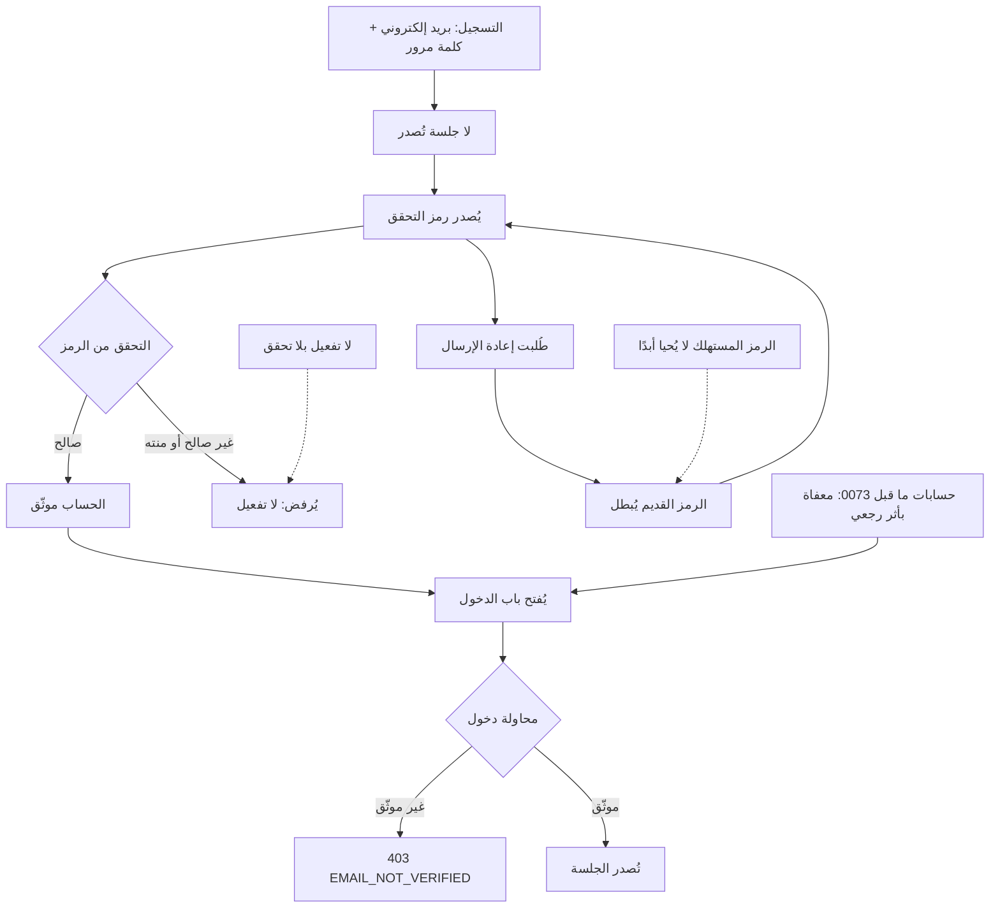
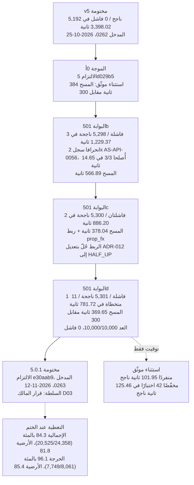
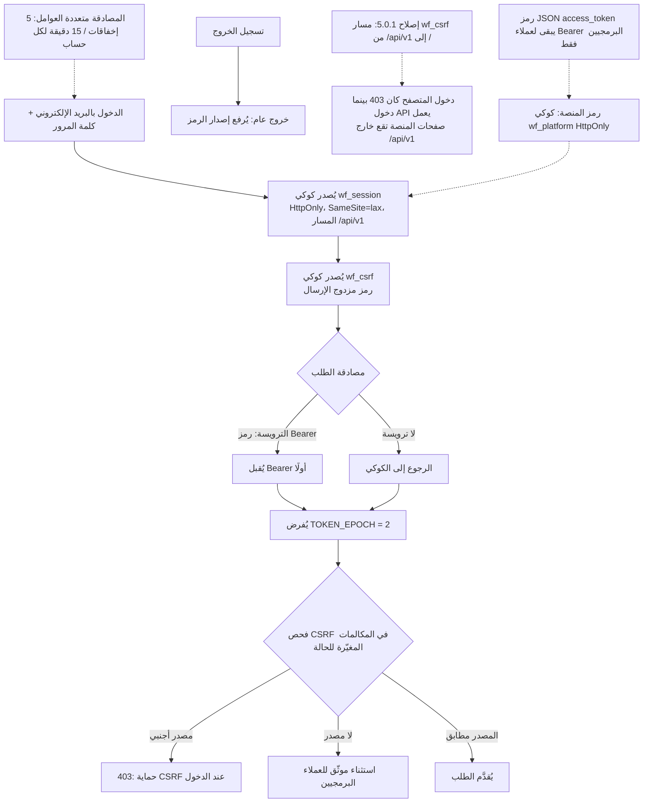
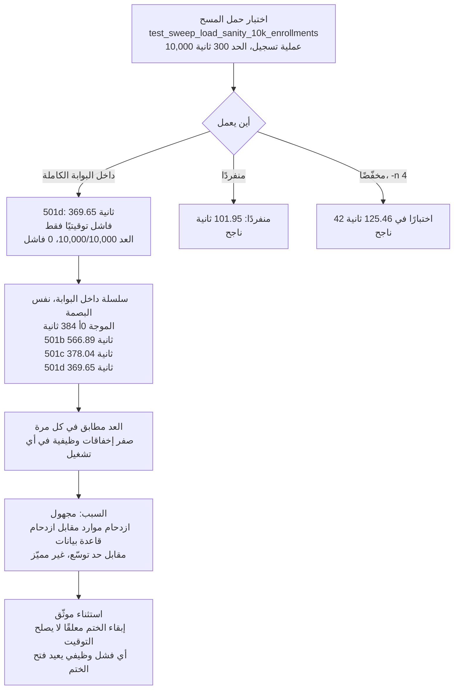
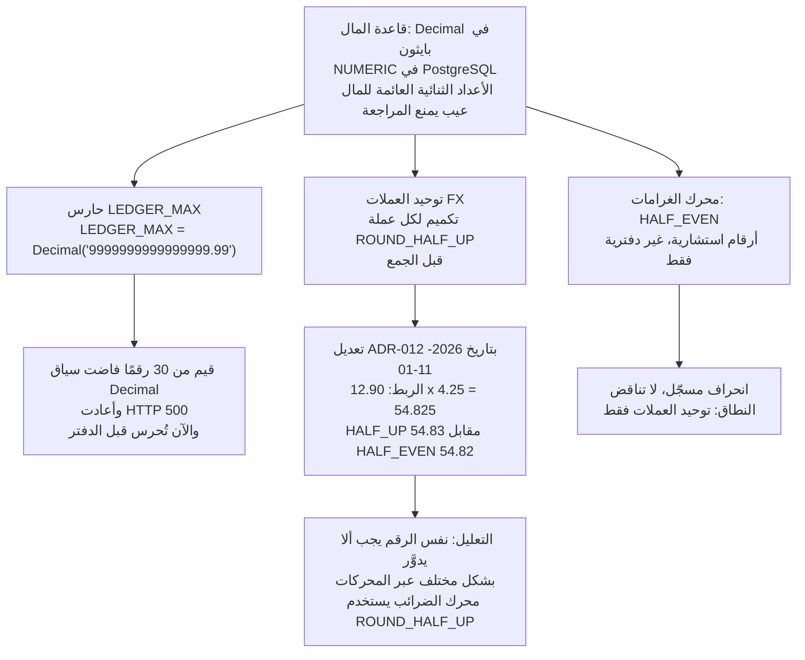
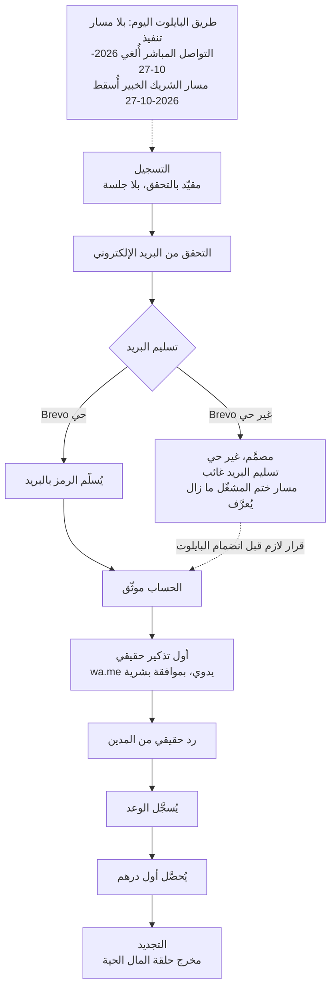

# OmniDues — مخططات جديدة (العربية)

ستة مخططات جديدة لختم 5.0.1، بُنيت في 2026-11-12. الإنجليزية هي الشجرة العامة الأساسية؛ وهذه النسخة العربية الموازية لها (`diagrams-ar.md`) — نفس المخططات، تسميات عربية، ومعرّفات عقد لاتينية.

**الحالة: 5.0.1 مختومة** — الالتزام `e30aab9`، سجل الأدلة Entry 0263، بتاريخ 2026-11-12، بقرار المالك D03. الختم يصدّق على البناء الهندسي فقط؛ والتقييم المكتبي الصارم B2B يمنح المنتج 513/1000 — فشل للإنتاج، ونجاح مشروط للبايلوت فقط.

**مصادر كل رقم أدناه:** سجل الأدلة `docs/gates/EVIDENCE_LOG.md`، المدخلان 0262 و0263، وملف `FINAL_REPORT_501.md`. لا رقم هنا من ملخص أو من ذاكرة. وحيث يسجّل المصدر أن السبب مجهول، يقول المخطط إنه مجهول.

**بيانات تجريبية:** أي شاشة منتج تشير إليها هذه المخططات تعرض بيانات تجريبية للمستأجر الوهمي Demo Distribution SARL — وليست بيانات عملاء حقيقيين أبدًا.

---

## 1. دورة حياة التحقق من البريد الإلكتروني (الهجرة 0073)

التسجيل مقيّد بالتحقق. لا تُصدر أي جلسة عند التسجيل، ونقطة التسجيل لا تكشف شيئًا عن وجود العنوان (لا خطأ 409 كاشفًا).

المصادر: المدخل 0263 — الهجرة `0073_email_verification`؛ الدخول يرفض الحساب غير الموثّق بالرمز 403 `EMAIL_NOT_VERIFIED`؛ إعفاء حسابات ما قبل 0073. قواعد إعادة الإرسال (الرمز القديم يُبطل عند إعادة الإرسال، والرمز المستهلك لا يُحيا أبدًا، ولا تفعيل بلا تحقق) من الإصلاح المستهدف في 501b، المثبت على الجهاز بنجاح 3/3 في 14.65 ثانية.

---

## 2. سلسلة ختم 5.0.1

من ختم v5 إلى ختم 5.0.1. كل بوابة في السلسلة حمراء بتوقيت المسح فقط؛ وكل عدد في المسح مطابق تمامًا.

المصادر: المدخلان 0262 و0263؛ وملف `FINAL_REPORT_501.md`. الاستثناء يغطي التوقيت فقط — أي فشل وظيفي يعيد فتح الختم. وسبب توقيت المسح مجهول (ازدحام موارد مقابل ازدحام قاعدة بيانات مقابل حد توسّع — غير مميّز)؛ وإبقاء الختم معلقًا لا يصلح التوقيت.

---

## 3. تدفق CSRF والجلسة

مصادقة تبدأ بـ Bearer مع رجوع إلى ملف تعريف الارتباط (كوكي)، ورمز CSRF مزدوج الإرسال، وتسجيل خروج عام. ويشمل إصلاح مسار الكوكي في 5.0.1.

المصادر: المدخل 0263 — إصلاحات الأمان P1؛ إصلاح مسار الكوكي `wf_csrf` (`/` بدل `/api/v1`)؛ حماية CSRF عند الدخول (المصدر الأجنبي إلى 403؛ وغياب المصدر استثناء موثّق للعملاء البرمجيين)؛ نُقل رمز المنصة إلى كوكي `wf_platform` من نوع HttpOnly؛ تقييد المصادقة متعددة العوامل (5 إخفاقات / 15 دقيقة، بدالة محدِّدة).

---

## 4. تشريح اختبار حمل المسح

اختبار واحد، وأربعة توقيتات داخل البوابة، وصفر إخفاقات وظيفية. الاختبار يسجّل 10,000 عملية تسجيل في أعمال التحصيل ويجب أن ينتهي في 300 ثانية.

المصادر: المدخل 0263؛ وملف `FINAL_REPORT_501.md`؛ وسجلات البوابات `device_gate_501b.log` و`device_gate_501c.log` و`device_gate_501d.log` (التشغيلات المنفردة والمخفّضة في `sweep_solo_501*.log` و`sweep_reduced_501*.log`).

---

## 5. خريطة ثوابت المال

المال Decimal وNUMERIC من الطرف إلى الطرف. حارسان وانحراف واحد مسجّل.

المصادر: المدخل 0263 (إصلاحات البوابة: حارس `LEDGER_MAX`؛ وتعديل ADR-012 إلى HALF_UP مع حفظ جملة القرار الأصلية حرفيًا كتاريخ)؛ وملف ADR-012 نفسه (الربط الدقيق 12.90 x 4.25 = 54.825؛ والنطاق توحيد العملات فقط؛ وHALF_EVEN في الغرامات محفوظ كانحراف مسجّل).

---

## 6. مسار انضمام البايلوت

الطريق المصمَّم من التسجيل إلى التجديد. وأجزاء تسليم البريد مصمَّمة لا حيّة — والمخطط يوسمها كذلك ولا يخفي الفجوة.

المصادر: المدخل 0263 — نتيجة التسجيل/Brevo (التسجيل الذاتي الجديد لا يكمل التحقق حتى يوجد تسليم بريد أو يُعرَّف مسار ختم المشغّل)؛ وتصميم 0b للبايلوت (wa.me اليدوي القناة الافتراضية، وضع المسودة بموافقة بشرية)؛ والمدخل 0263 — طريق البايلوت اليوم بلا مسار تنفيذ.

---

## ملاحظة العرض

المخططات كتل Mermaid من نوع `flowchart`، يعرضها GitHub أصليًا. معرّفات العقد لاتينية فقط في كلا الملفين؛ والتسميات وحدها هي ما يتغير بين `diagrams-en.md` و`diagrams-ar.md`. وإن فشل عرض مخطط، فأول مشتبه به هو بناء من نوع `timeline` — ولا واحد مستعمل هنا؛ فالستة كلها `flowchart`.
