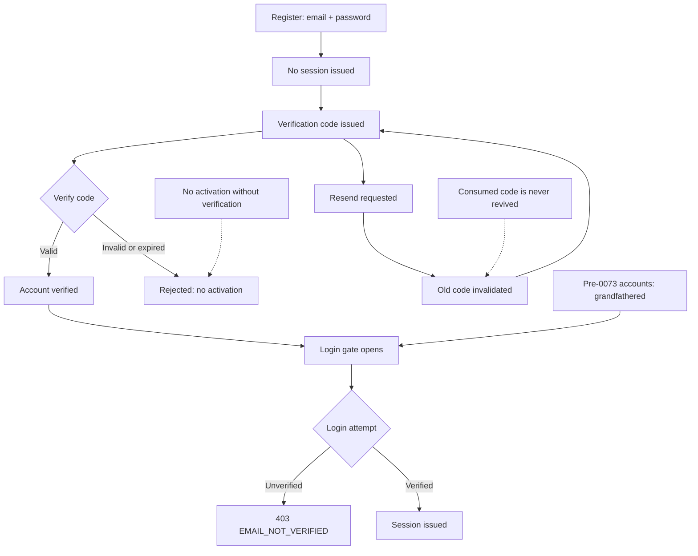
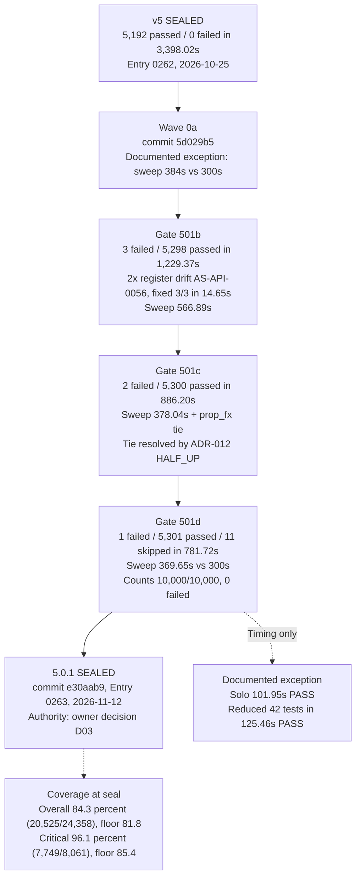
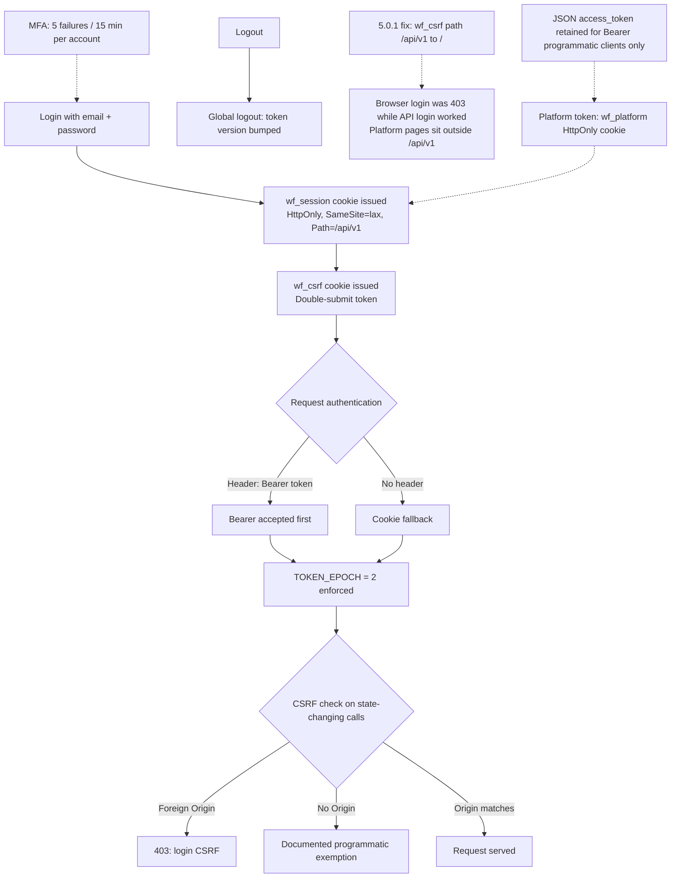
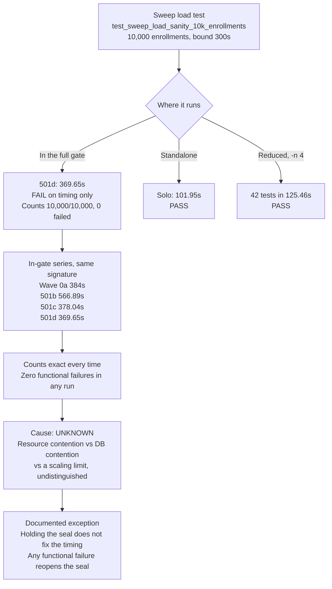
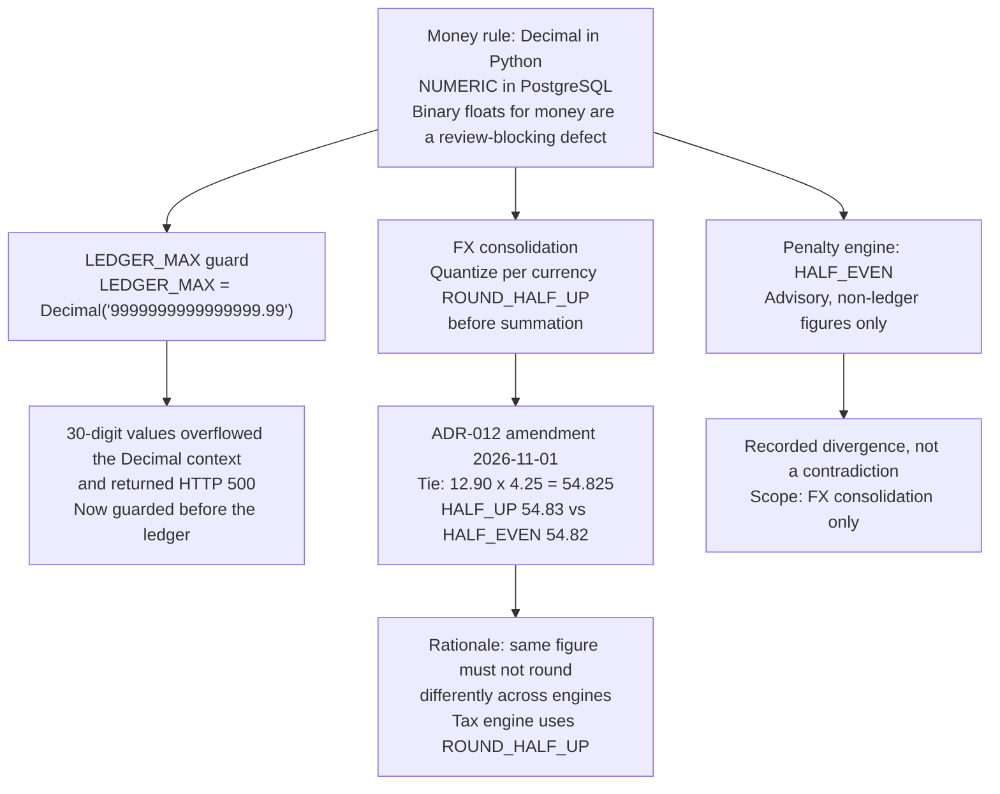
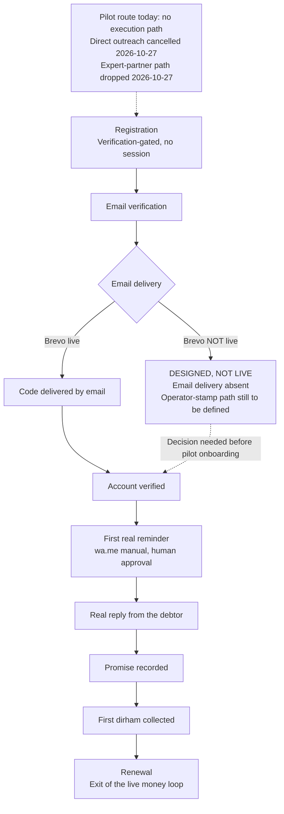

# OmniDues — New Diagrams (English)

Six new diagrams for the 5.0.1 seal, built 2026-11-12. English is the primary public tree; the Arabic parallel is `diagrams-ar.md` (same diagrams, Arabic labels, Latin node IDs).

**Status: 5.0.1 is SEALED** — commit `e30aab9`, EVIDENCE_LOG Entry 0263, 2026-11-12, by owner decision D03. The seal certifies the engineering build only; the strict B2B desk assessment scores the product 513/1000 — FAIL for production, conditional pilot only.

**Sources for every number below:** `docs/gates/EVIDENCE_LOG.md` Entries 0262 and 0263, and `FINAL_REPORT_501.md`. No number here comes from a summary or a memory. Where the record states a cause as unknown, the diagram states it as unknown.

**Demo data:** any product screen referenced by these diagrams shows demo data for the fictional tenant Demo Distribution SARL — never real customers.

---

## 1. Email verification lifecycle (migration 0073)

Registration is verification-gated. No session is issued at register time, and the register endpoint discloses nothing about whether an address exists (no 409 oracle).

Sources: Entry 0263 — migration `0073_email_verification`; login refuses unverified accounts with 403 `EMAIL_NOT_VERIFIED`; grandfathering for pre-0073 accounts. Resend rules (old code invalidated on resend, consumed code never revived, no activation without verification) from the 501b targeted fix, device-proven green 3/3 in 14.65s.

---

## 2. The 5.0.1 seal chain

From the v5 seal to the 5.0.1 seal. Every gate in the chain is red on the sweep timing only; every sweep count is exact.

Sources: Entries 0262 and 0263; FINAL_REPORT_501.md. The exception covers timing only — any functional failure reopens the seal. The sweep-timing cause is unknown (resource contention vs DB contention vs a scaling limit — undistinguished); holding the seal does not fix the timing.

---

## 3. CSRF and session flow

Bearer-first authentication with a cookie fallback, a double-submit CSRF token, and a global logout. Includes the 5.0.1 cookie-path fix.

Sources: Entry 0263 — security P1 fixes; the `wf_csrf` cookie-path fix (`/` instead of `/api/v1`); login CSRF (foreign Origin to 403; no-Origin as documented programmatic exemption); platform token moved to the `wf_platform` HttpOnly cookie; MFA per-account throttling (5 failures / 15 min, definer-function limiter).

---

## 4. Sweep load-test anatomy

One test, four in-gate timings, zero functional failures. The test enrolls 10,000 tenants' worth of collections work and must finish inside 300 seconds.

Sources: Entry 0263; FINAL_REPORT_501.md; gate logs `device_gate_501b.log`, `device_gate_501c.log`, `device_gate_501d.log` (solo and reduced runs in `sweep_solo_501*.log`, `sweep_reduced_501*.log`).

---

## 5. Money invariants map

Money is Decimal and NUMERIC end to end. Two guards and one recorded divergence.

Sources: Entry 0263 (gate fixes: `LEDGER_MAX` guard; ADR-012 amended to HALF_UP, original Decision sentence preserved verbatim as history); ADR-012 itself (exact tie 12.90 x 4.25 = 54.825; scope FX consolidation only; penalty HALF_EVEN untouched as a recorded divergence).

---

## 6. Pilot onboarding path

The designed route from registration to renewal. The email-delivery parts are designed, not live — the diagram marks them as such and does not hide the gap.

Sources: Entry 0263 — registration/Brevo consequence (a brand-new self-registration cannot complete verification until email delivery exists or an operator-stamp path is defined); the 0b pilot design (wa.me manual as the default channel, draft-with-human-approval mode); Entry 0263 — the pilot route is currently without an execution path.

---

## Rendering note

Diagrams are Mermaid `flowchart` blocks, rendered natively by GitHub. Node IDs are Latin-only in both language files; only the labels change between `diagrams-en.md` and `diagrams-ar.md`. If a diagram fails to render, the first suspect is the `timeline`-style construct — none is used here; all six are `flowchart`.
