# Diagrams

All diagrams are Mermaid (GitHub renders Mermaid natively). Every label is in English. Every element matches a verified fact in the other documents of this repository; where a flow detail is not in the record, it is left out rather than invented. **v3 adds diagrams 6–12** to the five diagrams of v2: the money lifecycle, payment recording, bank matching, workers and outbox, authentication and session lifecycle, audit chain and restore, and the gate / seal lifecycle.

What is intentionally **not** shown here:

- Live PSP, bank-feed, WhatsApp Cloud, and email-delivery flows are Tier 3 gated and not live, so they appear only as gated external systems in the context diagram, never as working flows.
- The exact execution order of the middleware components is not asserted (see [architecture.md](architecture.md)).
- No production deployment topology is shown, because no production deployment exists; the only running copy is a trial on the owner's PC (loopback only).

## 1. System context

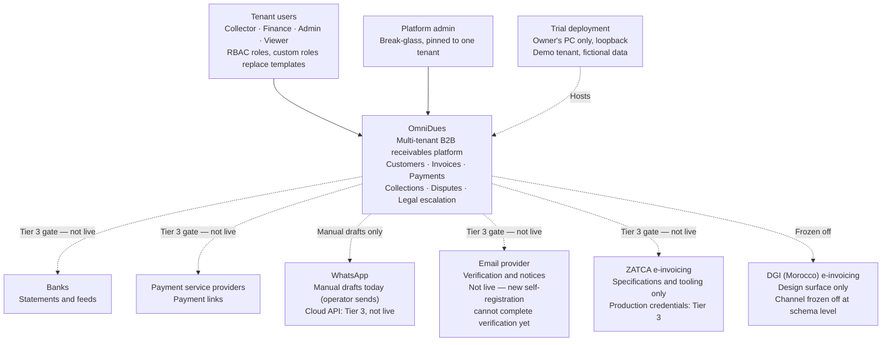

## 2. Containers

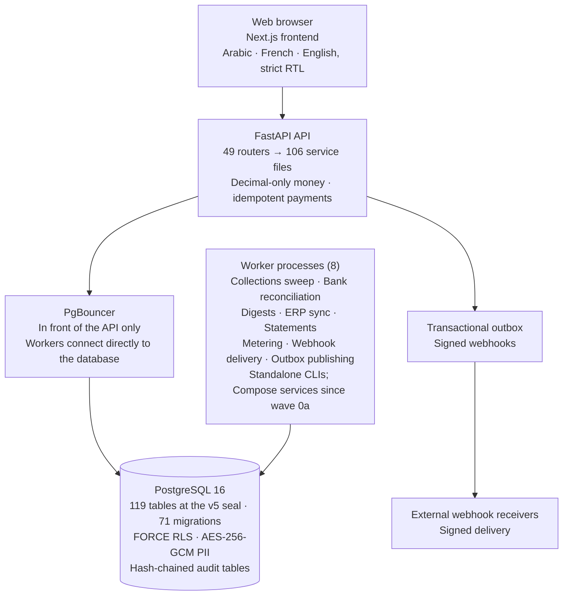

## 3. Tenant isolation — request flow

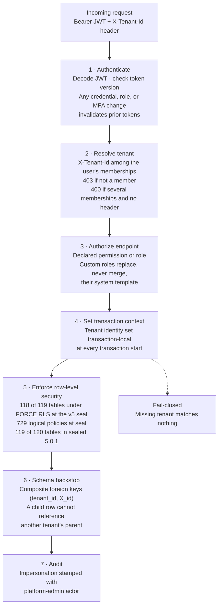

## 4. Collections workflow

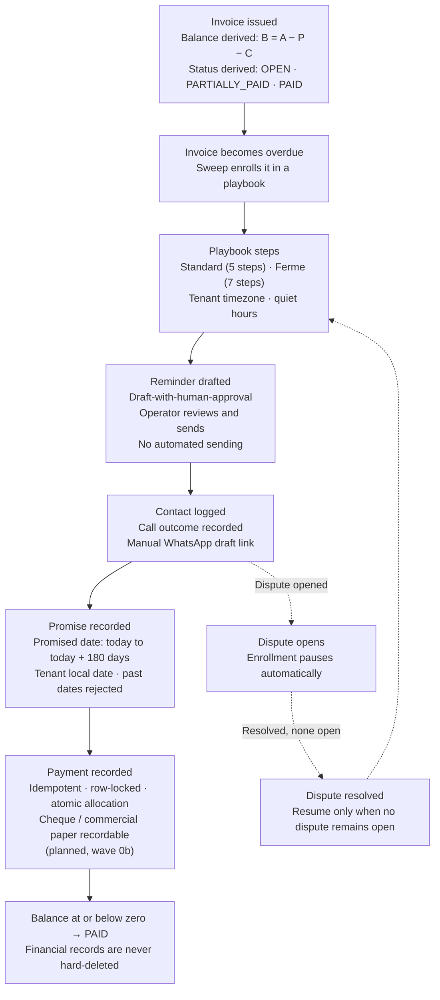

## 5. Data flow and encryption

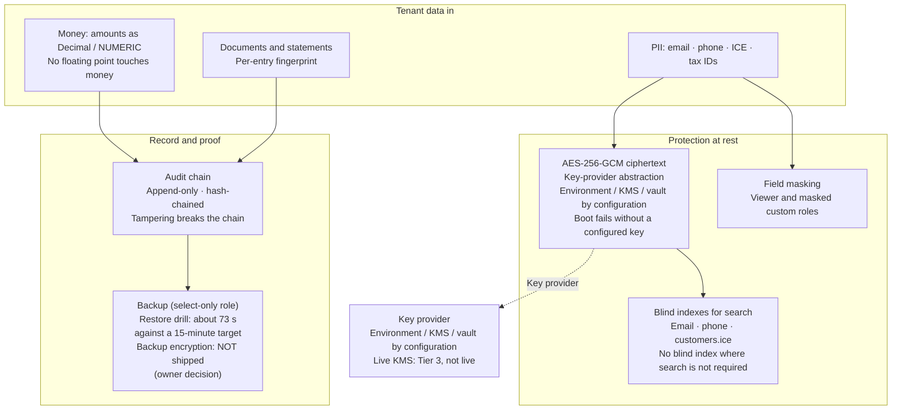

## 6. Money lifecycle — invoice state machine

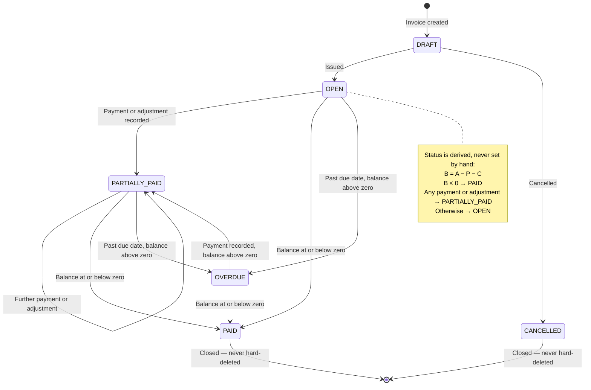

## 7. Payment recording — sequence

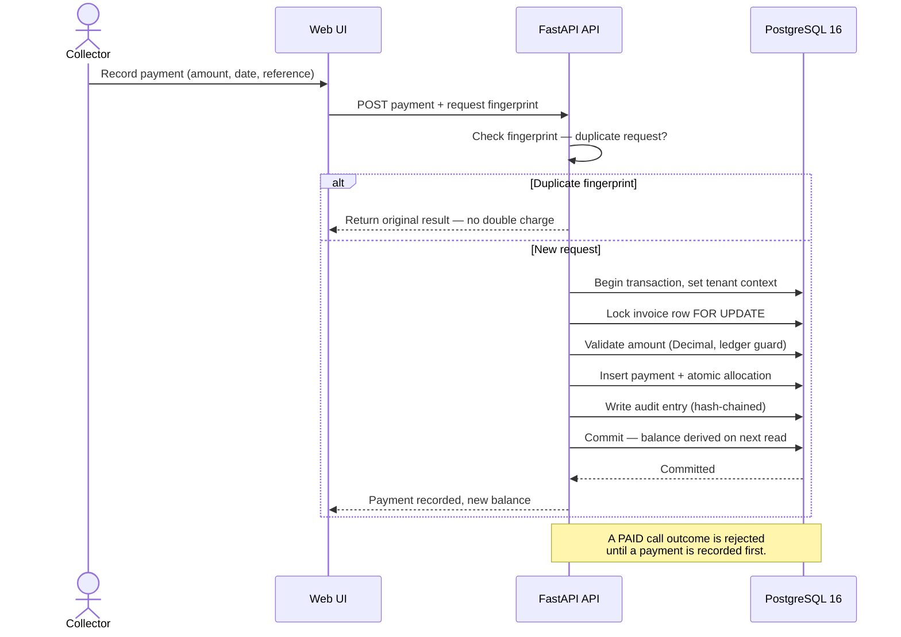

## 8. Bank matching — from statement to reconciliation

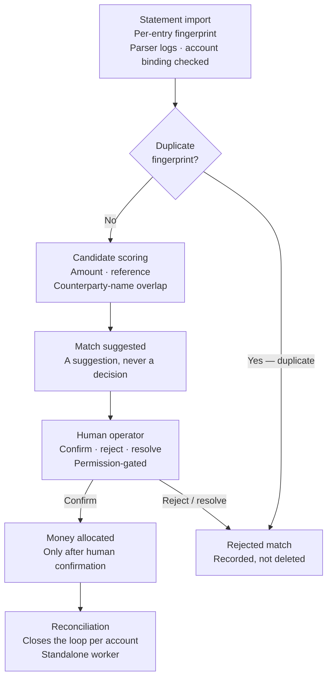

## 9. Workers and outbox

```mermaid
flowchart TB
    subgraph App["FastAPI API"]
        Txn["Business transaction<br/>Writes domain rows + outbox row<br/>in the same transaction"]
    end
    subgraph Workers["Worker processes (8)"]
        Sweep["Collections sweep"]
        Recon["Bank reconciliation"]
        Digest["Digests"]
        ERP["ERP sync"]
        Stmt["Statements"]
        Meter["Metering"]
        Hook["Webhook delivery"]
        Out["Outbox publishing"]
    end
    DB[("PostgreSQL 16<br/>Workers connect directly<br/>Never through PgBouncer")]
    Recv["External webhook receivers<br/>Signed delivery"]

    Txn --> DB
    Workers --> DB
    Out --> Recv
    Hook --> Recv
    Txn -.->|"Outbox row"| Out
    note right of Out
        Outbox publishing is also available
        as an optional in-application task.
        Retention is CLI-only: --once,
        --apply required before any
        deletion or anonymization.
    end note
```

## 10. Authentication and session lifecycle

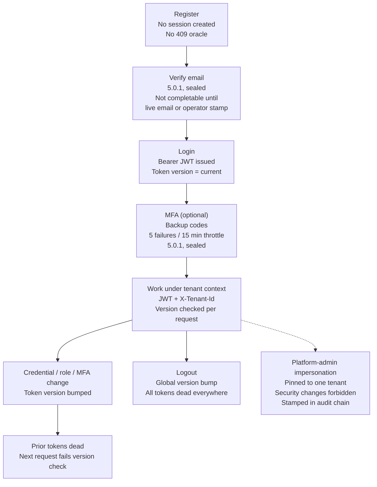

## 11. Audit chain and restore

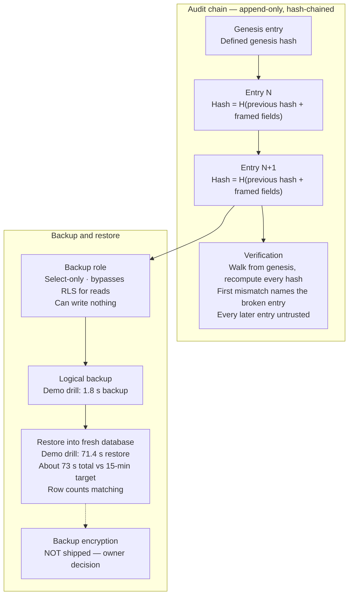

## 12. Gate and seal lifecycle

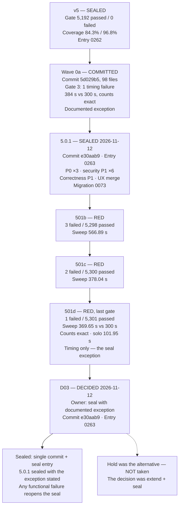

## 13. RBAC and permissions

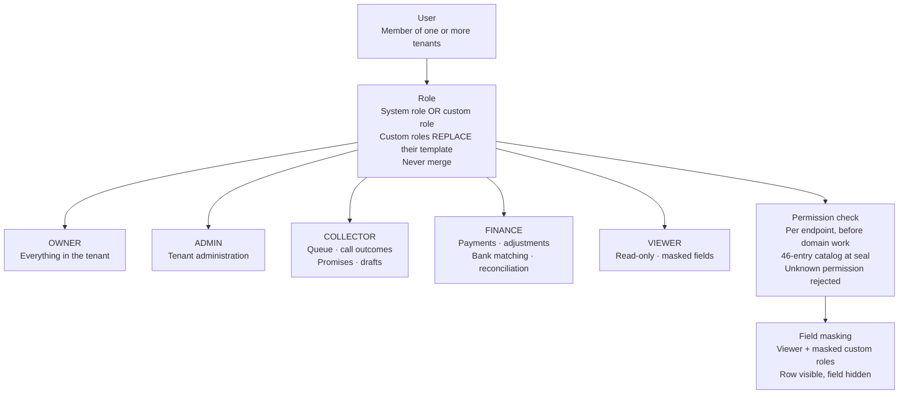

## 14. API surface

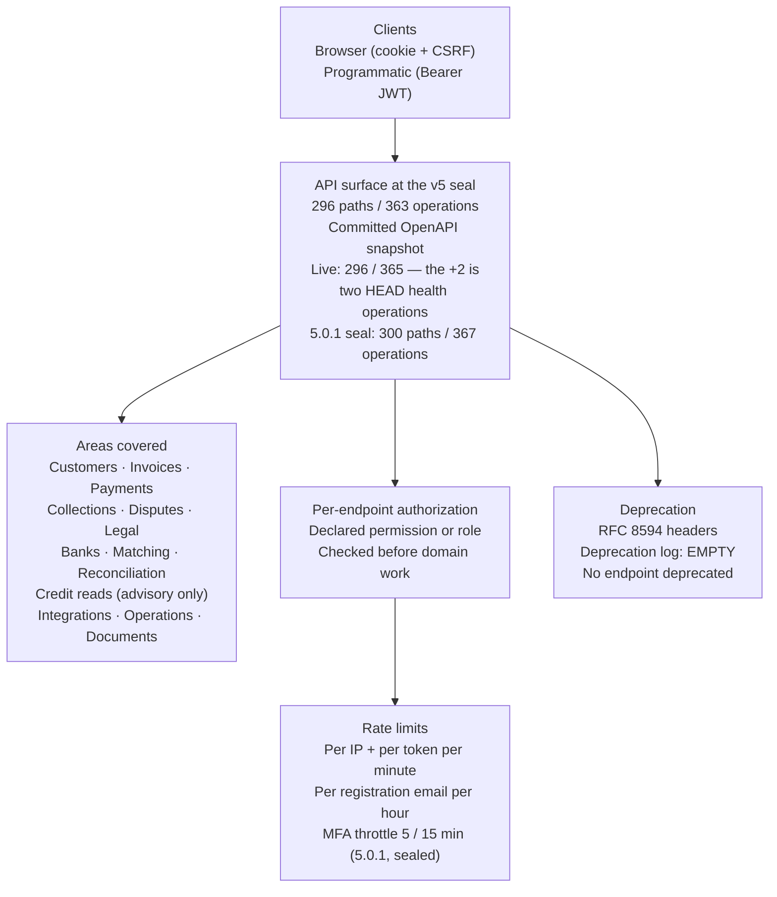

## 15. Data-model groups

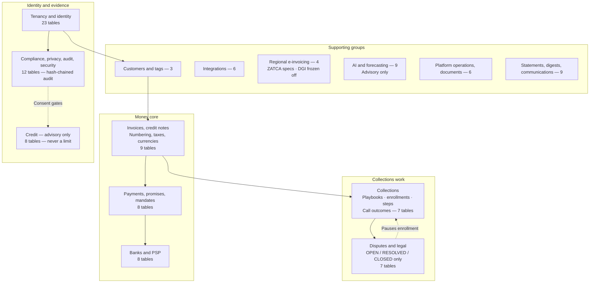

## 16. Trial deployment

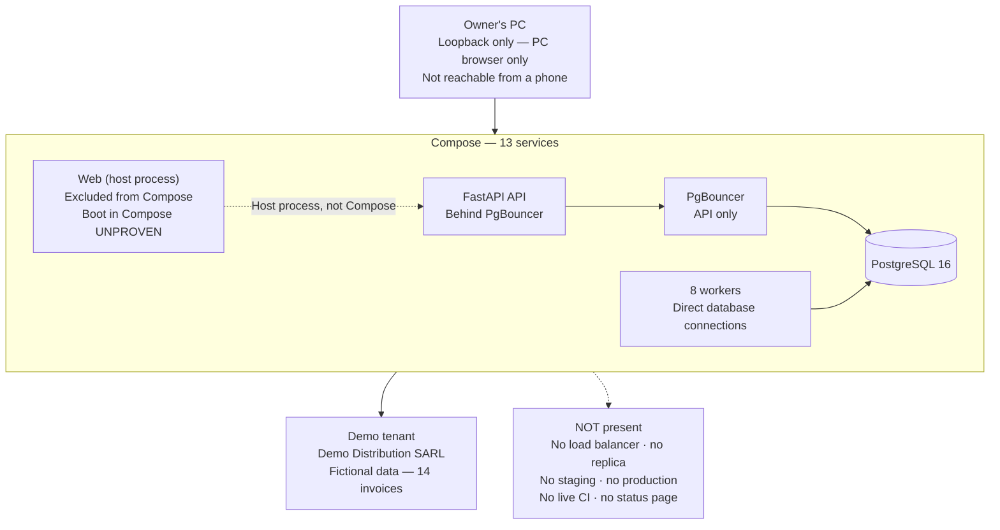

## 17. Promise and dispute states

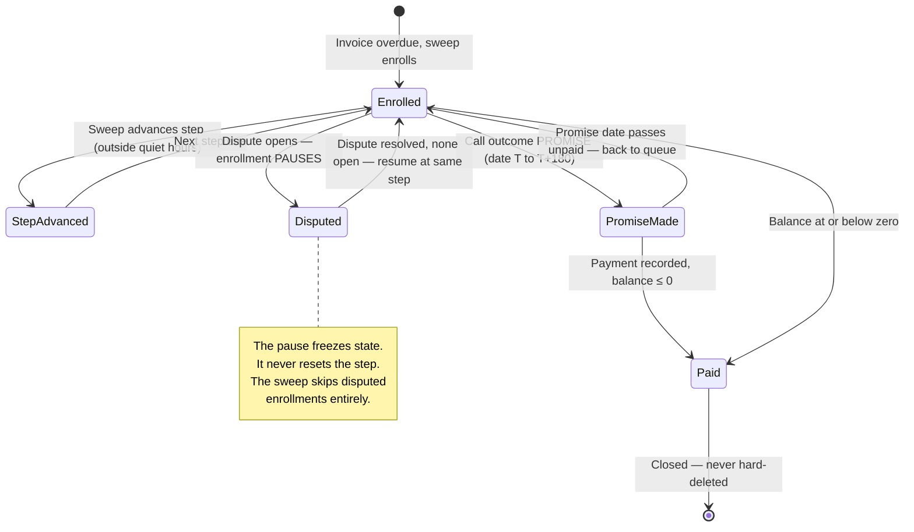

## 18. FX rounding — HALF_UP before summation

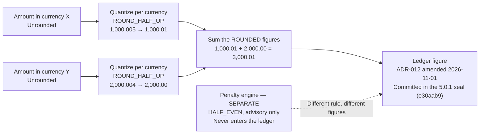

## 19. Gate timeline

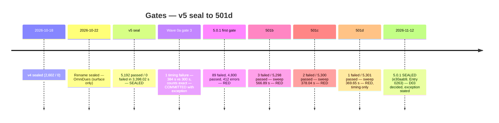

## 20. Commercial readiness — desk assessment 513 / 1000

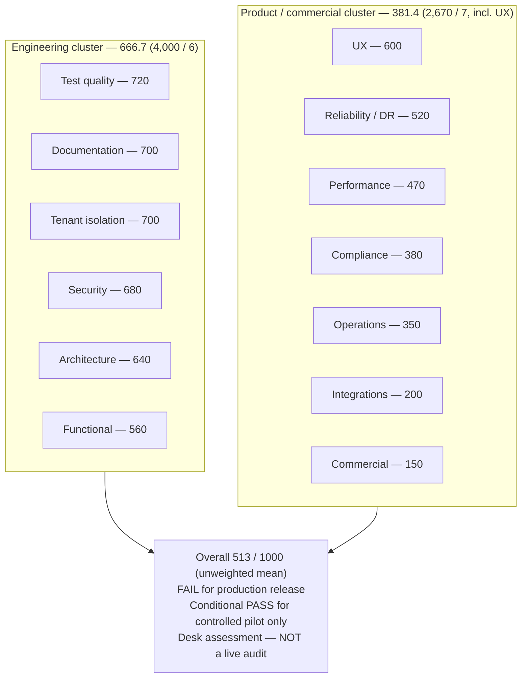
